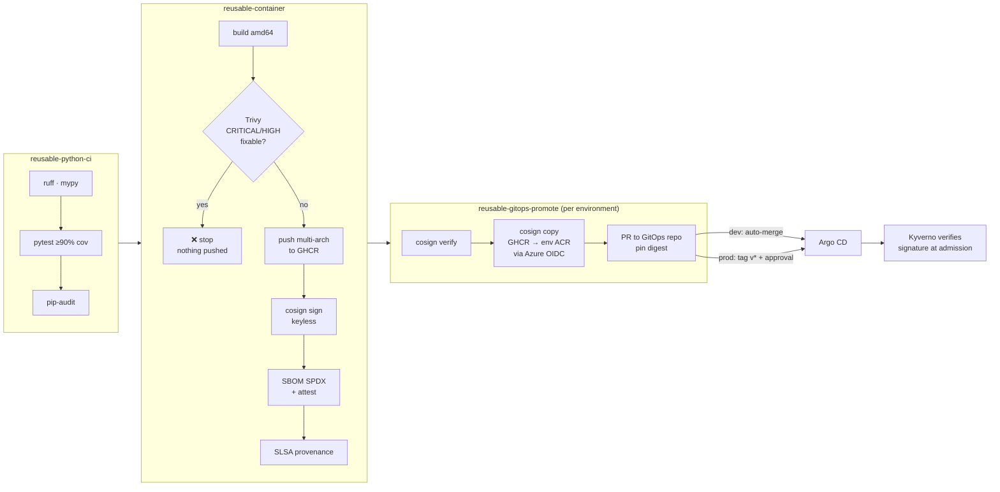

# secure-cicd-golden-path

Reusable GitHub Actions workflows that take a service from commit to a **signed,
scanned, SBOM-attested image promoted by digest through GitOps** — without a single
long-lived cloud credential.

Teams don't copy pipeline YAML; they call three workflows:

```yaml
jobs:
  ci:
    uses: gastonhp1/secure-cicd-golden-path/.github/workflows/reusable-python-ci.yml@v1
    with: { working-directory: . }
  container:
    needs: ci
    uses: gastonhp1/secure-cicd-golden-path/.github/workflows/reusable-container.yml@v1
    with: { image-name: my-service, context: . }
```

`apps/demo-api` is the reference service that runs on
[azure-aks-gitops-platform](https://github.com/gastonhp1/azure-aks-gitops-platform).

## Pipeline



| Trigger | What happens |
|---|---|
| Pull request | CI + build + **blocking** vulnerability scan. Nothing is pushed or signed. |
| Push to `main` | Push + sign + attest → promote to **dev** (PR auto-merges) |
| Tag `v*` | Same image flow → promote to **prod** (GitHub environment with required reviewers) |

## Security properties

| Property | How |
|---|---|
| No static cloud credentials | Azure access via GitHub OIDC → managed identity; subject bound to the GitHub **environment**, not the branch |
| Build once, deploy many | One multi-arch digest; `cosign copy` moves it (with signatures) between registries. Tags are never trusted. |
| Vulnerable images never ship | Trivy runs on a local build **before** push; HIGH/CRITICAL with an available fix fail the job |
| Provenance is verifiable | Sigstore keyless signature whose identity is the reusable workflow file + GitHub artifact attestation (SLSA build provenance) |
| Cluster enforces it | The platform's Kyverno policy trusts exactly `…/reusable-container.yml@refs/heads/main` or `@refs/tags/v*` |
| Cross-repo writes are scoped | GitHub App token, 1 hour, only `contents` + `pull-requests` on the GitOps repo |
| The pipeline is code-reviewed too | `actionlint` (+ shellcheck) and `zizmor` on every change to `.github/`; Renovate pins actions to commit SHAs |
| No script injection | Every `${{ }}` that reaches a shell goes through `env:` first |

## Try it

```bash
make venv test lint     # app checks, same as CI
make image scan         # local image + the same Trivy gate
make run                # http://localhost:8080/api/v1/info

# verify a published image end to end (signature, SBOM attestation, provenance)
make verify REF=ghcr.io/gastonhp1/demo-api@sha256:<digest>
```

## Setup (one time)

1. **GitHub environments** `dev` and `prod` (Settings → Environments). On `prod`: required
   reviewers and "Selected branches and tags" → `v*`.
2. **Azure identities**: created by `azure-aks-gitops-platform` (`module.github_ci_identity`), or
   standalone with `scripts/setup-azure-oidc.sh <rg> <acr> <env>`. Put the printed values in each
   environment's variables: `AZURE_CLIENT_ID`, `AZURE_TENANT_ID`, `AZURE_SUBSCRIPTION_ID`, `ACR_LOGIN_SERVER`.
   Without `ACR_LOGIN_SERVER` the environment deploys straight from GHCR (handy for kind).
3. **GitHub App** for the GitOps repo: permissions *Contents: write* and *Pull requests: write*,
   installed only on `azure-aks-gitops-platform`. Store `GITOPS_APP_ID` and `GITOPS_APP_PRIVATE_KEY`
   as repository secrets. Enable *Allow auto-merge* on the GitOps repo for dev.
4. Make the `demo-api` GHCR package public so a kind cluster can pull it without credentials.

More detail in [docs/design.md](docs/design.md).

## Roadmap

- [ ] GitLab CI equivalents (`templates/gitlab/`) using `include:` components
- [ ] Container-structure tests and a Dockerfile linter (hadolint) stage
- [ ] DAST smoke test (ZAP baseline) against the dev URL after promotion

## License

MIT
